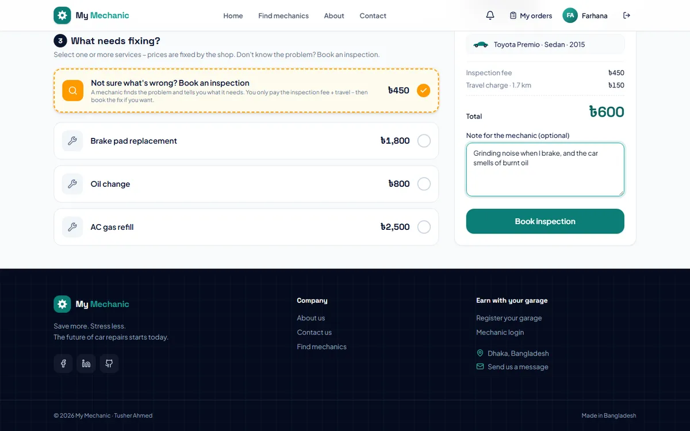
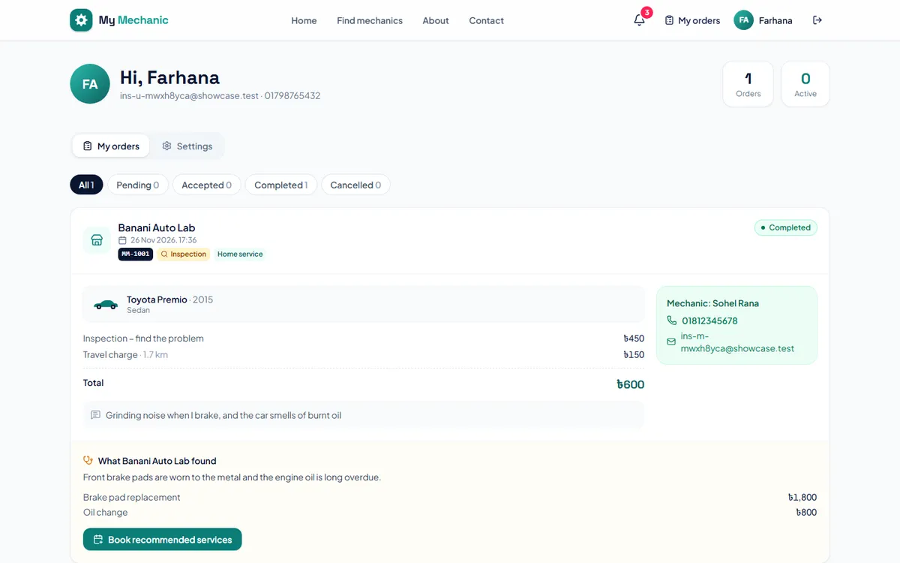
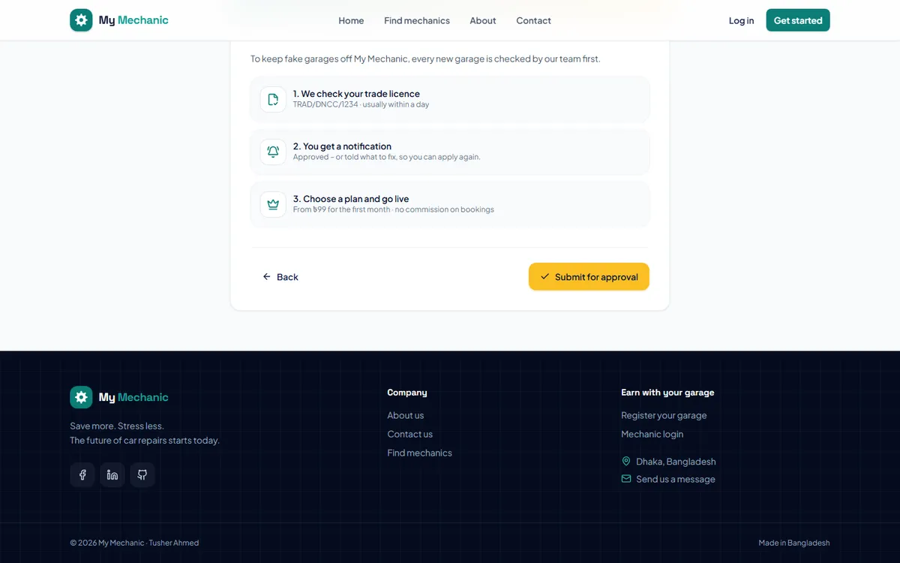
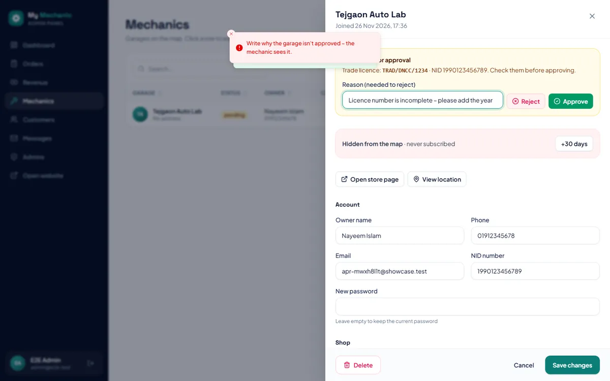
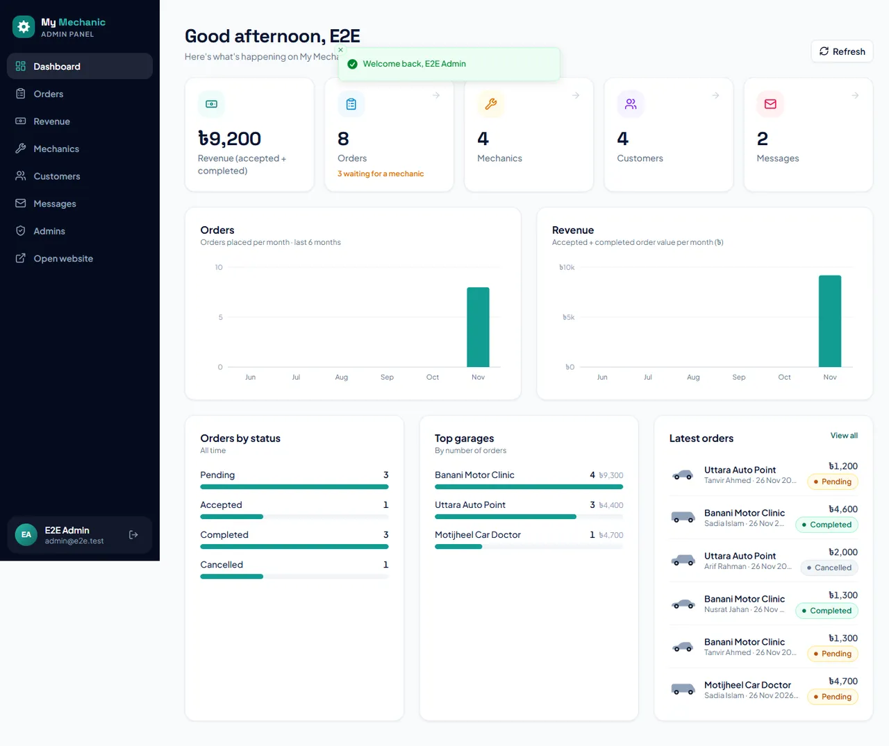
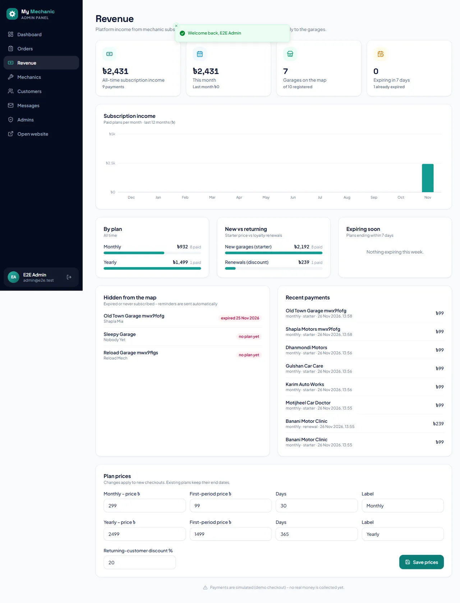

<div align="center">

# 🔧 My Mechanic

**Find a trusted car mechanic near you – on a live map, with upfront prices, in minutes.**

A full-stack web platform that connects car owners with nearby, verified garages in Bangladesh.

React 19 · Vite · Tailwind CSS · Node.js · Express 5 · MongoDB · Server-Sent Events · Playwright

**[🌐 Live website](https://my-mechanic-tau.vercel.app)** · **[🛠️ Admin panel](https://my-mechanic-admin.vercel.app)**

</div>


## Live demo

- **Website:** [my-mechanic-tau.vercel.app](https://my-mechanic-tau.vercel.app)
- **Admin panel:** [my-mechanic-admin.vercel.app](https://my-mechanic-admin.vercel.app)

Try it as a customer with `rahim@demo.mymechanic` / `demo1234`, or as a mechanic with
`karim@demo.mymechanic` / `demo1234`. The API runs on a free server that sleeps when unused, so the first request
can take up to a minute.

## The idea

When your car breaks down somewhere you don't know, finding a garage street by street takes time – and you
don't know what it will cost. **My Mechanic** shows the garages around you on a map with their services and
prices. You book what you need (or an inspection if you don't know the problem) and follow the mechanic as
they come to you.

## Project history

I built My Mechanic in **2022** as my university project, using React 17 (Create React App), Express and
MongoDB, split across three repositories (website, admin panel and API).

Coming back to it years later, the old project no longer worked properly: many packages were outdated or
broken (some with security warnings), Create React App was no longer maintained, and it had bugs from my
early days as a developer. Instead of patching it, I **rearranged and rebuilt the project**:

- merged the three repositories into **this one repository** (website, admin panel, API and tests together);
- moved to current versions of everything (React 19, Vite, Express 5, Mongoose 8) and replaced broken packages;
- fixed the old bugs and redesigned the website and admin panel;
- added real-time notifications, live location, proper security and automated tests, plus new features such as
  inspections, garage approval and subscriptions.

The original repositories are kept for reference.

## Features

### Car owners

- **Live map** of garages with search, "near me" sorting and a car-type filter.
- **Booking:** your car, where to meet (*mechanic comes to me* or *I'll bring the car in*) and the services.
- **Not sure what's wrong?** Book an **inspection** – pay only the garage's inspection fee and travel. The
  mechanic writes what they found and recommends services, which you book in one tap without paying travel again.
- **Upfront prices** with a distance-based travel charge calculated by the server.
- **Order number, arrival countdown and a 4-digit code** to confirm the right mechanic arrived.
- **Live location sharing** with the mechanic – only after they accept and only during the job.
- **Real-time notifications**; cancel an order with a reason.

### Mechanics

- **Registration with a trade licence** – an admin verifies the garage before it goes live.
- New requests show the **distance and approximate area** before accepting; then the customer's live location.
- Accept with an **arrival time**, verify the customer's code on arrival, finish inspections with findings.
- **Own revenue** – service income and travel charges reported separately; cancelled jobs never count.
- Shop settings: services and prices, inspection fee, car types, location and travel pricing.
- **7-day free trial** once the garage is approved, then **subscription plans** (monthly / yearly) with reminders and a loyalty discount on renewal.

### Admins

- **Garage approvals:** check the trade licence, approve or reject with a reason, or revoke a live garage later. Garages added by an admin are approved at once.
- Dashboard and **revenue** reports (orders, service and travel charges, subscription income), editable plan prices.
- Manage orders, mechanics, customers, contact messages and admins.

## Screenshots

| Map with nearby garages | Booking an inspection |
|---|---|
|  |  |

| Inspection result with recommended services | Mechanic: customer's live location |
|---|---|
|  |  |

| Customer: verification code and arrival countdown | Mechanic: own revenue |
|---|---|
|  |  |

| Registration: approval step | Admin: approving a garage |
|---|---|
|  |  |

| Admin dashboard | Admin revenue |
|---|---|
|  |  |

## Tech stack

| Part | Technologies |
|---|---|
| **Website** (`client/`) | React 19, Vite, React Router 7, Tailwind CSS 4, Motion, MapLibre GL + OpenStreetMap |
| **Admin panel** (`admin/`) | React 19, Vite, Tailwind CSS 4, Motion, hand-built SVG charts |
| **API** (`server/`) | Node.js, Express 5, MongoDB (Mongoose), Zod, JWT, Server-Sent Events |
| **Tests** (`e2e/`) | Playwright – API tests and browser walk-throughs |

Maps use free OpenStreetMap data – no API key needed.

## Run it locally

Needs Node.js 20.6+ and MongoDB (local or a free Atlas cluster).

```bash
npm install
cp server/.env.example server/.env    # set MONGO_URL, JWT_SECRET and the admin login
cp client/.env.example client/.env
cp admin/.env.example  admin/.env
npm run seed:admin                    # create the first admin
npm run seed:demo                     # optional: demo garages + a demo customer (password demo1234)
npm run dev                           # API, website and admin together
```

## Testing

All tests use Playwright against a separate test database that is wiped on every run.

- **134 API tests**, including 15 security tests that perform real attacks (NoSQL injection, forged tokens,
  price manipulation, mass assignment, brute force).
- **10 browser walk-throughs** of the full customer → mechanic → admin journey on production builds.

```bash
npm run test:api
npm run showcase
```

## Security

- Every request is validated (Zod); unknown fields are dropped and Mongo operators rejected.
- JWT login with instant session revocation on password change; bcrypt-hashed passwords.
- Role checks on every route – users and mechanics only see their own data.
- Prices, travel charges and totals are always calculated by the server.
- Garages are verified by trade licence before they can take bookings.
- Phone numbers are shared only after acceptance; exact location only during the job.
- Helmet headers, CORS allow-list and rate limits on login, registration and the contact form.

## Business model

Customers pay the garage directly – the platform takes **no commission**. It earns from **garage subscriptions**:
a free trial for new garages, low starter prices for the first month or year, and a discount for returning garages. Only approved garages with an
active plan appear on the map. Payments currently use a demo checkout, ready for a real gateway (e.g. SSLCommerz, bKash).

## Author

**Tusher Ahmed** · [GitHub](https://github.com/Tusher-Ahmed) · [LinkedIn](https://www.linkedin.com/in/tusher-ahmed-6b9b70210/)
