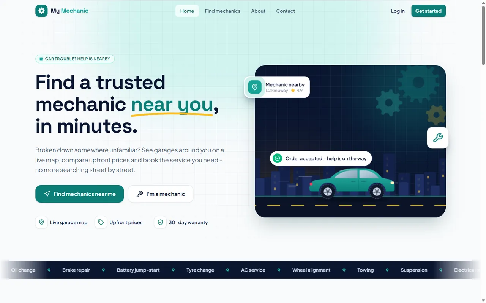
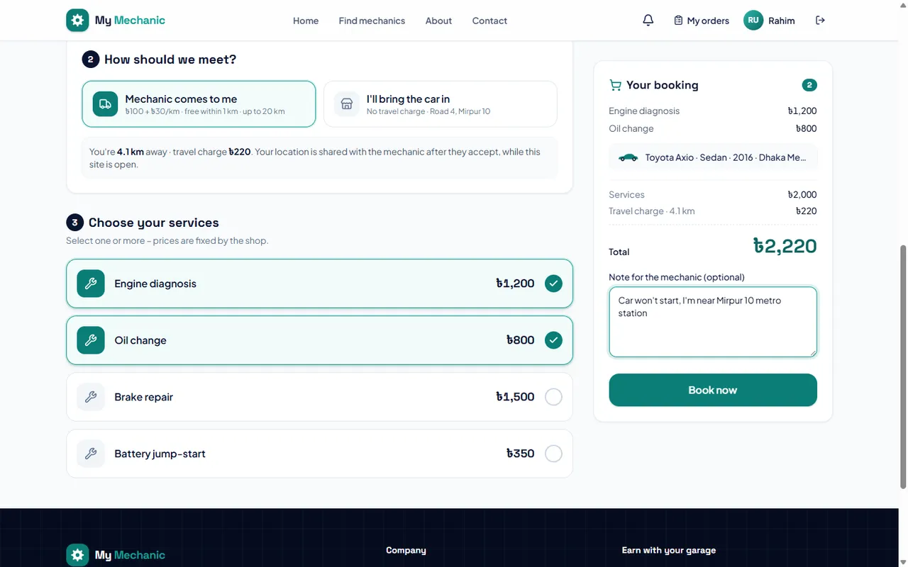
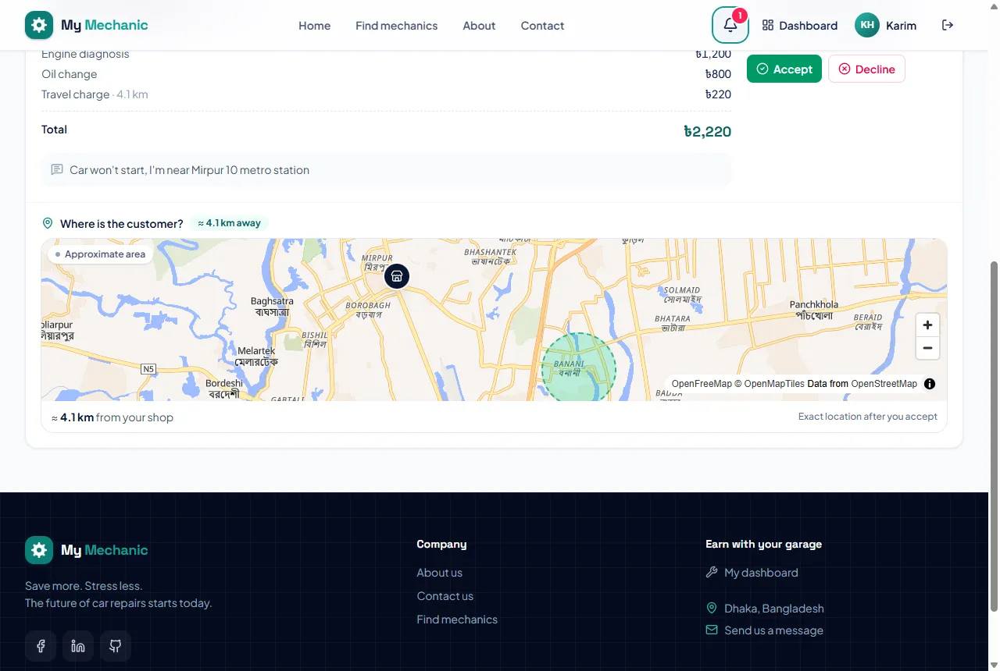
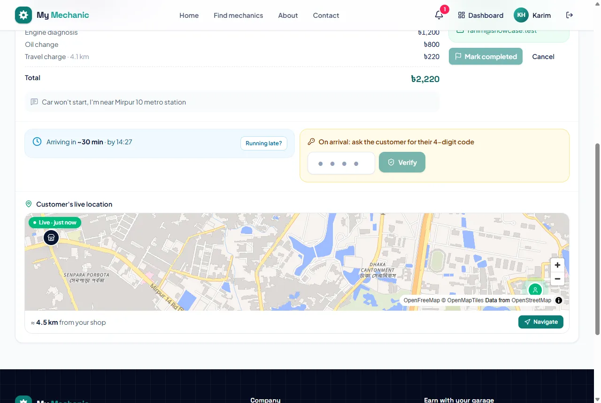
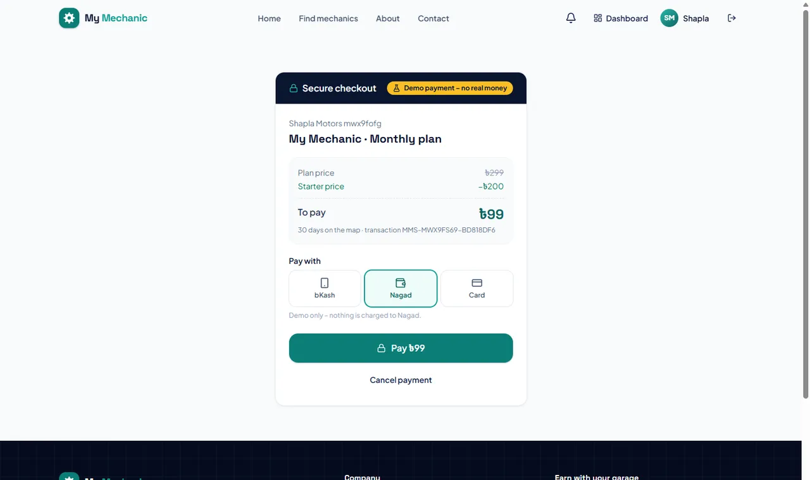
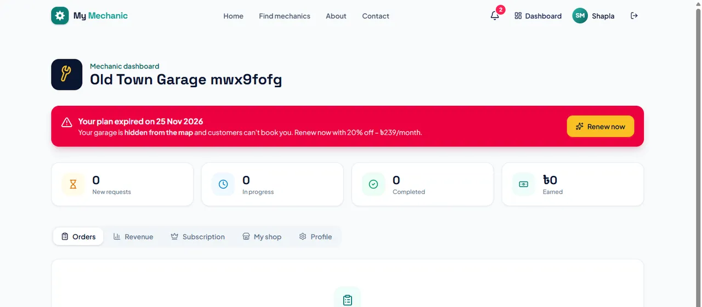
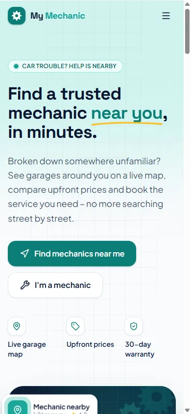

<div align="center">

# 🔧 My Mechanic

**Find a trusted car mechanic near you – on a live map, with upfront prices, in minutes.**

A full-stack web platform that connects car owners with nearby garages in Bangladesh:
customers find a mechanic on the map, book services for their car and track the mechanic's arrival;
garages get bookings, a live view of where the customer is, and their own revenue dashboard.

React 19 · Vite · Tailwind CSS · Node.js · Express 5 · MongoDB · Server-Sent Events · Playwright

</div>



---

## Contents

- [The idea](#the-idea)
- [Features](#features)
- [Screenshots](#screenshots)
- [Tech stack](#tech-stack)
- [Architecture](#architecture)
- [Project structure](#project-structure)
- [Getting started](#getting-started)
- [Environment variables](#environment-variables)
- [Testing](#testing)
- [Security](#security)
- [Business model](#business-model)
- [API overview](#api-overview)
- [Deployment](#deployment)
- [Author](#author)

---

## The idea

Suppose your car breaks down somewhere you don't know, and there's nobody around to ask for help.
Looking for a garage street by street takes a long time – and you don't know what it will cost.

**My Mechanic** solves this: open the map, see the garages around you with their services and prices,
book what you need and follow the mechanic as they come to you. Mechanics register their garage once and
receive bookings from drivers nearby.

The project started as my university project (React 17 + Express, three separate repositories) and has been
rebuilt from the ground up as one repository with a modern stack, a real-time order flow, proper security
and automated tests.

## Features

### For car owners
- **Live map of garages** (OpenStreetMap) with search by shop or service, **"near me"** sorting by distance
  and a **car-type filter** (searchable dropdown).
- **Booking in three steps:** your car (type, make, model, year, plate – saved cars are remembered),
  **how to meet** (*mechanic comes to me* or *I'll bring the car in*) and services.
- **Upfront pricing:** service prices plus a **distance-based travel charge**, calculated by the server.
- **Order number** (e.g. `MM-1042`), **arrival countdown** and a **4-digit code** to confirm the right mechanic arrived.
- **Live location sharing** with the mechanic (only after they accept, only while the site is open, stops automatically).
- **Real-time notifications** (bell + toasts) for every status change.

### For mechanics / garages
- **5-step registration** with a map location picker, services and prices, car types serviced and a plan.
- **Dashboard:** new requests with **distance + approximate area** (exact location only after accepting),
  accept with an **arrival time** (suggested from the distance), "running late" updates,
  **customer verification by code** on arrival, completion.
- **Live map** of the customer's position with distance and a **Navigate** button (Google Maps directions).
- **Own business numbers:** revenue and orders per month, what earns the most.
- **Shop settings:** services, car types, location, travel pricing (base, per km, free radius, max distance).
- **Subscription:** monthly / yearly plans, renew banner when expired, reminders before expiry.

### For admins
- **Dashboard** with orders, revenue charts, order status and top garages.
- **Revenue page:** subscription income per month and plan, new vs returning garages,
  expiring / hidden garages, recent payments and an editable **plan-price** form.
- Manage **orders** (status, details, delete), **mechanics** (shop, services, travel pricing, plan),
  **customers** (saved cars), **messages** from the contact form and **admins**.

### Design
- Animated SVG visuals built in code (driving car, meshing gears, wrench) following a consistent motion system
  (`client/src/lib/motion.js`) – respects *reduced motion*.
- Fully responsive, tested at phone width; long names and many car types never break the layout.
- Colourblind-safe, single-hue charts with hover tooltips and screen-reader tables.

## Screenshots

| Map with nearby garages | Booking – car, travel charge, services |
|---|---|
|  |  |

| Mechanic: new order with distance (before accepting) | Mechanic: customer's live location |
|---|---|
|  |  |

| Customer: verification code and arrival countdown | Mechanic: own revenue |
|---|---|
|  |  |

| Subscription: demo checkout | Expired plan: renew banner |
|---|---|
|  |  |

| Admin dashboard | Admin revenue |
|---|---|
|  |  |

<p align="center"></p>

## Tech stack

| Part | Technologies |
|---|---|
| **Website** (`client/`) | React 19, Vite, React Router 7, Tailwind CSS 4, Motion (animations), MapLibre GL + OpenStreetMap (OpenFreeMap tiles), Axios, Sonner (toasts), Lucide icons |
| **Admin panel** (`admin/`) | React 19, Vite, Tailwind CSS 4, Motion, hand-built SVG charts |
| **API** (`server/`) | Node.js 20+, Express 5, MongoDB with Mongoose 8, Zod validation, JWT auth, bcryptjs, Helmet, express-rate-limit, Server-Sent Events |
| **Tests** (`e2e/`) | Playwright – API tests and browser walk-throughs against production builds |

## Architecture

```
 ┌──────────────┐   HTTPS / JSON (JWT)    ┌──────────────────────┐        ┌───────────┐
 │  Website     │ ──────────────────────▶ │  Express API         │ ─────▶ │  MongoDB  │
 │  (client)    │ ◀── Server-Sent Events ─│  validation · auth   │        └───────────┘
 └──────────────┘    (notifications,      │  orders · pricing    │
 ┌──────────────┐     live location)      │  subscriptions       │
 │ Admin panel  │ ──────────────────────▶ │  hourly reminder job │
 └──────────────┘                         └──────────────────────┘
        │  map tiles
        ▼
  OpenFreeMap / OpenStreetMap (no API key)
```

- **Real time:** one Server-Sent Events stream per logged-in user delivers notifications and the customer's
  live location to the mechanic. The browser reconnects automatically and catches up on missed items.
- **The server decides everything that matters:** prices, travel charges, totals, distances, who may see what.
- **Privacy by design:** phone numbers after acceptance, approximate area before acceptance,
  exact location only during the job, location deleted when the job ends, admins never see coordinates.

## Project structure

```
My-Mechanic-Client/
├── client/            website for car owners and mechanics (Vite + React)
│   └── src/  pages/ components/ context/ lib/ data/
├── admin/             admin panel (Vite + React)
├── server/            REST API (Express + MongoDB)
│   └── src/  config/ models/ routes/ middleware/ services/ validation/ utils/ scripts/
├── e2e/               Playwright tests and showcase walk-throughs
├── docs/screenshots/  images used in this README
├── TASKS.md           task tracker of the modernization
└── TESTING.md         every test case with its status
```

## Getting started

### Prerequisites
- **Node.js 20.6+** and npm
- **MongoDB** running locally (`mongodb://127.0.0.1:27017`) – or a free MongoDB Atlas cluster

### 1. Install

```bash
git clone https://github.com/Tusher-Ahmed/My-Mechanic-Client.git
cd My-Mechanic-Client
npm install                       # installs server, client, admin and e2e (npm workspaces)
```

### 2. Configure

```bash
cp server/.env.example server/.env     # then set JWT_SECRET and ADMIN_PASSWORD
cp client/.env.example client/.env
cp admin/.env.example  admin/.env
```

### 3. Create the first admin and start everything

```bash
npm run seed:admin    # creates the admin from ADMIN_EMAIL / ADMIN_PASSWORD in server/.env
npm run dev           # API :8080 · website :5173 · admin :5174
```

| App | URL |
|---|---|
| Website | http://localhost:5173 |
| Admin panel | http://localhost:5174 |
| API health check | http://localhost:8080/api/health |

> New garages appear on the map once they have an active plan. Register a mechanic, choose a plan and
> "pay" with the demo checkout – or grant a plan from the admin panel (**Mechanics → +30 days**).

### Useful scripts

| Command | What it does |
|---|---|
| `npm run dev` | Run API, website and admin together |
| `npm run dev:server` / `dev:client` / `dev:admin` | Run one app |
| `npm run build` | Production build of website and admin |
| `npm run seed:admin` | Create (or reset the password of) the admin account |
| `npm run test:api` | API tests |
| `npm run showcase` | Browser walk-throughs in a visible window (screenshots + video) |
| `npm test` | Everything: API tests, then the walk-throughs |

## Environment variables

**`server/.env`**

| Variable | Description |
|---|---|
| `PORT` | API port (default `8080`) |
| `MONGO_URL` | MongoDB connection string |
| `JWT_SECRET` | Long random string for signing login tokens (≥ 32 characters in production) |
| `JWT_EXPIRES_IN` | Login lifetime, e.g. `7d` |
| `CORS_ORIGINS` | Comma-separated website + admin URLs allowed to call the API |
| `ADMIN_USERNAME` / `ADMIN_EMAIL` / `ADMIN_PASSWORD` | First admin, used by `npm run seed:admin` |
| `LOGIN_RATE_LIMIT` / `REGISTER_RATE_LIMIT` / `CONTACT_RATE_LIMIT` | Optional limits per IP (defaults 20 / 15 min, 10 / hour, 10 / hour) |

**`client/.env`** – `VITE_API_URL` (API base URL), optional `VITE_MAP_STYLE` (custom map style URL)

**`admin/.env`** – `VITE_API_URL`, `VITE_CLIENT_URL` (website URL for "open store page" links)

No map API key is needed – maps use free OpenStreetMap data.

## Testing

All tests use **Playwright** and run against a separate test database (`my-mechanic-e2e`, wiped on every run),
so development data is never touched. See **[TESTING.md](TESTING.md)** for every case.

- **106 API tests** – authentication, orders, notifications, live location, travel charges, arrival time and
  verification codes, subscriptions, admin, and **15 security tests that perform real attacks**
  (NoSQL injection, forged tokens, price manipulation, mass assignment, brute force …).
- **6 browser walk-throughs** against the production builds – the full customer → mechanic → admin journey
  (two browser windows, live notifications, GPS movement), subscriptions, a layout stress test with extreme data,
  and a page-reload regression check. Each run saves screenshots and a video.

```bash
npx playwright install chromium   # once
npm run test:api
npm run showcase
```

## Security

- **Validation:** every endpoint validates body, params and query with Zod; unknown fields are dropped.
- **Injection:** `$`-operators and dotted keys are rejected; Mongoose `sanitizeFilter` is on; search text is escaped.
- **Authentication:** JWT pinned to HS256; a token version on each account revokes old sessions instantly when the
  password changes, an admin resets it or the account is deleted; login takes the same time whether or not the
  email exists.
- **Passwords:** 8–72 characters with a letter and a number, bcrypt cost 12.
- **Authorization:** role checks on every route; users and mechanics only see their own data.
- **Server-side business rules:** prices, travel charges and totals are always recalculated; verification codes
  allow 5 tries and then lock for 15 minutes.
- **HTTP:** Helmet security headers, CORS allow-list, rate limits on login / registration / contact form,
  100 KB body limit, no stack traces in responses.

## Business model

Customers pay the garage directly for repairs – the platform takes **no commission**.
The platform earns from **garage subscriptions**:

| Plan | First period (starter) | Regular price | Returning customers |
|---|---|---|---|
| Monthly | ৳99 for 30 days | ৳299 | 20 % off renewals |
| Yearly | ৳1,499 for 365 days | ৳2,499 | 20 % off renewals |

- Only garages with an active plan appear on the map and can receive bookings.
- Reminders 7 days and 1 day before expiry, and when it expires; renewing early never loses days.
- Prices and the discount are editable in the admin panel.
- Payments currently use a **demo checkout** (no real money). The payment step is isolated in
  `server/src/routes/subscriptions.js` (`startCheckout()`), so a gateway such as SSLCommerz or bKash can be added later.

## API overview

All routes are under `/api`. 🔒 = login required (role in brackets).

| Area | Endpoints |
|---|---|
| Auth | `POST /auth/:role/register` · `POST /auth/:role/login` · 🔒 `GET/PUT /auth/me` |
| Garages | `GET /mechanics?q=&vehicleType=` · `GET /mechanics/:id` |
| Orders | 🔒 `POST /orders` (user) · 🔒 `GET /orders/mine` · 🔒 `PATCH /orders/:id/status` · 🔒 `PATCH /orders/:id/location` (user) · 🔒 `PATCH /orders/:id/eta` (mechanic) · 🔒 `POST /orders/:id/verify` (mechanic) |
| Notifications | 🔒 `GET /notifications` · 🔒 `GET /notifications/stream` (SSE) · 🔒 `PATCH /notifications/:id/read` · 🔒 `POST /notifications/read-all` |
| Subscriptions | `GET /subscriptions/plans` · 🔒 `GET /subscriptions/me` · 🔒 `POST /subscriptions/checkout` · 🔒 `POST /subscriptions/demo/:tranId/pay` (mechanic) |
| Contact | `POST /messages` |
| Admin | 🔒 `/admin/stats` · `/admin/revenue` · `/admin/plans` · `/admin/orders` · `/admin/users` · `/admin/mechanics` · `/admin/messages` · `/admin/admins` (admin) |
| Health | `GET /health` |

## Deployment

Planned free hosting:

| Part | Host |
|---|---|
| API (`server/`) | Render (free web service) |
| Website (`client/`) and admin (`admin/`) | Vercel (free) |
| Database | MongoDB Atlas (free M0 cluster) |

Step-by-step instructions will be added here once the deployment is live.

## Author

**Tusher Ahmed**

[GitHub](https://github.com/Tusher-Ahmed) · [LinkedIn](https://www.linkedin.com/in/tusher-ahmed-6b9b70210/)

Project presentation (original version):
[Google Slides](https://docs.google.com/presentation/d/11vKXGPKSR5Irre3PJkIuvo9b7oBikkT3/edit?usp=sharing&ouid=112073153374308217236&rtpof=true&sd=true)
